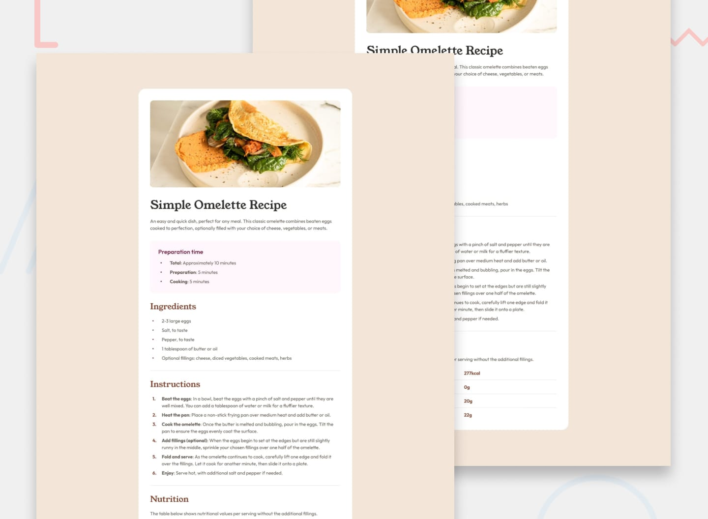

# Egg Recipe — Desafio do Frontend Mentor

Uma página de receita responsiva para um ovo frito, desenvolvida como parte de um desafio do Frontend Mentor. O projeto foi implementado com HTML semântico e CSS moderno, com foco em acessibilidade e responsividade para dispositivos móveis.

[Demo ao vivo](https://your-username.github.io/egg-recipe/) • [Desafio no Frontend Mentor](https://www.frontendmentor.io/challenges/recipe-page-KiTsR8QQKm?tab=submit)



## Sumário
- [Sobre o projeto](#sobre-o-projeto)
- [Funcionalidades](#funcionalidades)
- [Stack tecnológica](#stack-tecnológica)
- [Como visualizar / executar localmente](#como-visualizar--executar-localmente)

## Sobre o projeto
Este é um layout simples de uma página de receita que demonstra:
- design responsivo para mobile, tablet e desktop;
- estrutura HTML semântica;
- técnicas modernas de CSS (Flexbox / Grid);
- legibilidade visual e organização da informação.

O conteúdo foi mantido simples para seguir os requisitos do desafio do Frontend Mentor.

## Funcionalidades
- Totalmente responsivo
- HTML semântico
- Elementos acessíveis e foco visível
- Estrutura leve, com apenas HTML e CSS

## Stack tecnológica
- HTML5
- CSS3 (Flexbox / Grid)

## Como visualizar / executar localmente
1. Clone o repositório:
   ```bash
   git clone https://github.com/mavi-alt/egg-recipe.git
